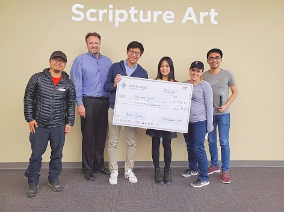

Our team received the People's Choice Award at Code for the Kingdom Seattle 2019 for a scripture-art application built during the 24-hour hackathon.

## Highlights

- Built a Python application with a Tk interface to generate images with randomly selected Bible verses.
- Selected complementary text colors in HSV color space using the background's mean color.
- Collaborated on a working prototype that combined software development, visual design, and our shared faith.

## Resources

- [Code for the Kingdom Seattle 2019](https://codeforthekingdom.org/seattle-hackathon-2019.html)
- [Scripture Art source code](https://github.com/blackmacy/Scripture_Art)
