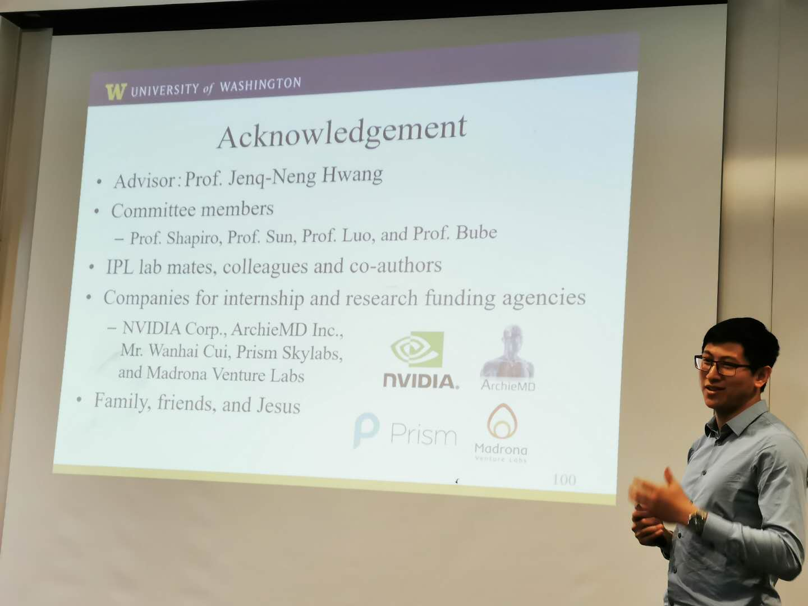

I successfully defended my Ph.D. in Electrical & Computer Engineering at the University of Washington. My dissertation, *Robust Video Object Tracking via Camera Self-Calibration*, studies how camera geometry can improve tracking and 3D scene understanding.

## Highlights

- Developed tracking methods for challenging conditions, including occlusion, illumination changes, and camera motion.
- Used camera self-calibration to estimate camera parameters from video observations.
- Connected object tracking and camera geometry to reconstruct movement in 3D scenes.

I am grateful to my committee—Jenq-Neng Hwang (chair), Kenneth P. Bube (GSR), Linda G. Shapiro, Ming-Ting Sun, and Fa-Long Luo—and to my colleagues, sponsors, family, and friends. My faith was also an important source of support throughout graduate school.

## Resources

- [UW Electrical & Computer Engineering](https://www.ece.uw.edu/)
- [Jenq-Neng Hwang](https://people.ece.uw.edu/hwang/)
- [Kenneth P. Bube](https://math.washington.edu/people/kenneth-p-bube)
- [Linda G. Shapiro](https://homes.cs.washington.edu/~shapiro/)
- [Ming-Ting Sun](https://people.ece.uw.edu/sun/)
- [Fa-Long Luo](https://ipl-uw.github.io/fa-long-luo.html)
