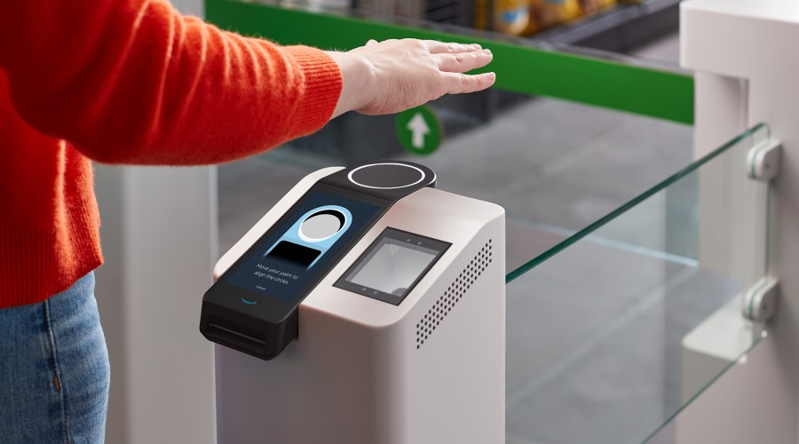

Amazon One launched as a contactless palm recognition service for payment, entry, and other identity-based activities. As an Applied Scientist on the research team, I developed methods for biometric identification and identity updates.

## Highlights

- Served as lead inventor on two U.S. patent applications covering the use of multiple sensor modalities for automated identification and mechanisms for updating identification data.
- Worked on recognition methods that combine palm and vein information, including adaptive identity updates.
- Contributed to a service that launched at two Amazon Go stores in Seattle, where customers could enroll a palm and use it for store entry.

## Resources

- [Introducing Amazon One](https://www.aboutamazon.com/news/innovation-at-amazon/introducing-amazon-one-a-new-innovation-to-make-everyday-activities-effortless)
- [Amazon One](https://one.amazon.com/)
