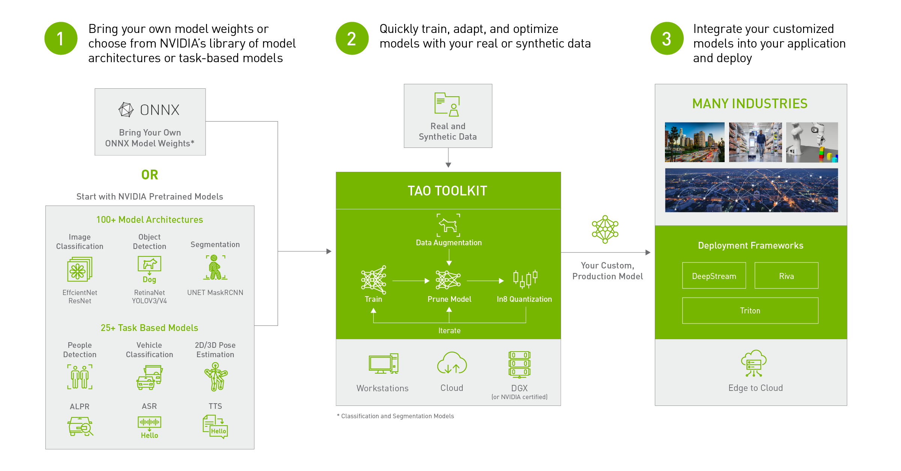

NVIDIA TAO Toolkit 4.0 provides tools for adapting and deploying vision models. My contributions focused on people re-identification, pose-based action recognition, and end-to-end video analytics samples.

## Highlights

- Developed people re-identification networks for matching identities across camera views.
- Developed pose-based action recognition networks for classifying human actions from body poses.
- Built Triton Inference Server samples that consume exported TensorRT engines, connecting TAO model training with inference and application integration.

## Resources

- [NVIDIA TAO Toolkit](https://developer.nvidia.com/tao-toolkit)
- [NVIDIA Triton Inference Server](https://developer.nvidia.com/nvidia-triton-inference-server)
