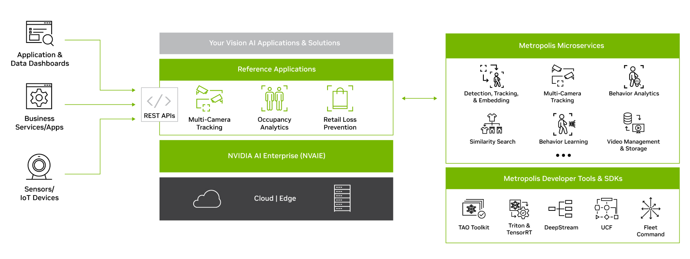

NVIDIA Metropolis AI Workflows & Microservices 1.0 introduced cloud-native reference applications for video analytics. I developed the multi-camera tracking application, which associates people across camera views and provides unique-person counts over time.

## Highlights

- Processed detection and tracking metadata into behaviors containing trajectories and appearance embeddings.
- Clustered behaviors using re-identification embeddings and spatiotemporal constraints to associate identities across cameras.
- Supported real-time analytics through API endpoints and browser-based visualization, using components such as Kafka and Elasticsearch.
- Integrated the tracking service into a broader workflow that includes camera calibration, object detection, and single-camera tracking.

## Resources

- [NVIDIA Metropolis Microservices](https://developer.nvidia.com/metropolis-microservices)
- [Multi-camera tracking demo](https://demos.ngc.nvidia.com/metropolis_multicam)
