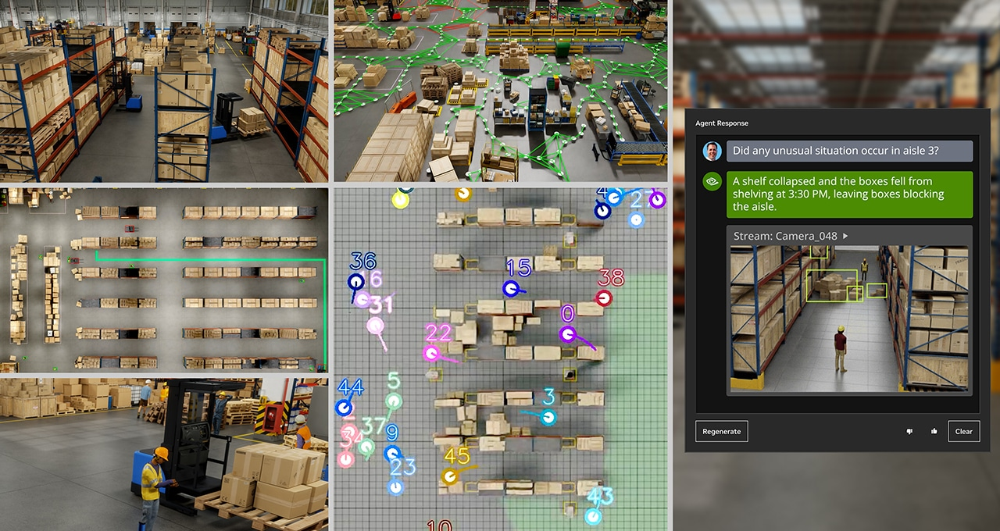

At GTC 2024, NVIDIA demonstrated how real-time AI and digital twins can work together in industrial environments. My multi-camera tracking work contributed to the Metropolis perception component of a demonstration combining Omniverse, Isaac, and cuOpt.

## Highlights

- Combined observations from 100 simulated cameras to represent people and activity across a warehouse.
- Used the shared scene view to inform robot-routing workflows and update occupancy information when conditions changed.
- Connected perception, simulation, and route optimization so developers could test industrial scenarios before physical deployment.

## Resources

- [NVIDIA's GTC 2024 industrial automation demonstration](https://blogs.nvidia.com/blog/ai-digital-twins-industrial-automation-demo/)
