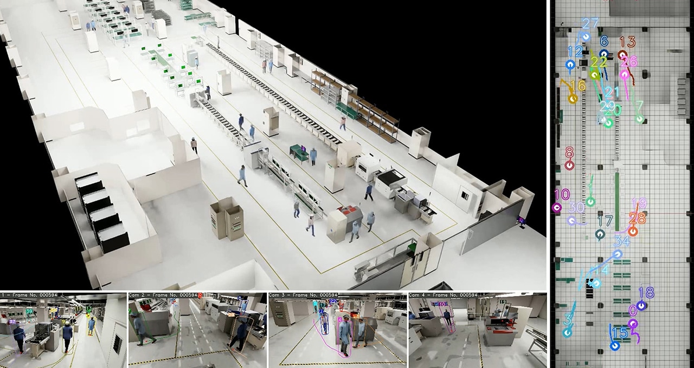

COMPUTEX 2024 highlighted industrial applications of NVIDIA Metropolis, NIM microservices, and Omniverse. Manufacturers and software partners described workflows that connect factory video, digital twins, and AI-assisted analysis.

## Highlights

- Foxconn and Ingrasys used Omniverse and Metropolis for factory digital twins and camera-placement planning.
- Pegatron adopted Metropolis multi-camera tracking reference workflows to connect factory monitoring with digital twins.
- Linker Vision used NIM and the Visual Insight Agent framework to support natural-language questions about factory video.

## Resources

- [NVIDIA's COMPUTEX 2024 industrial automation coverage](https://blogs.nvidia.com/blog/computex-metropolis-nim/)
- [NVIDIA Omniverse](https://www.nvidia.com/en-us/omniverse/)
- [NVIDIA Visual Insight Agent](https://www.nvidia.com/en-us/ai-data-science/visual-insight-agent/)
