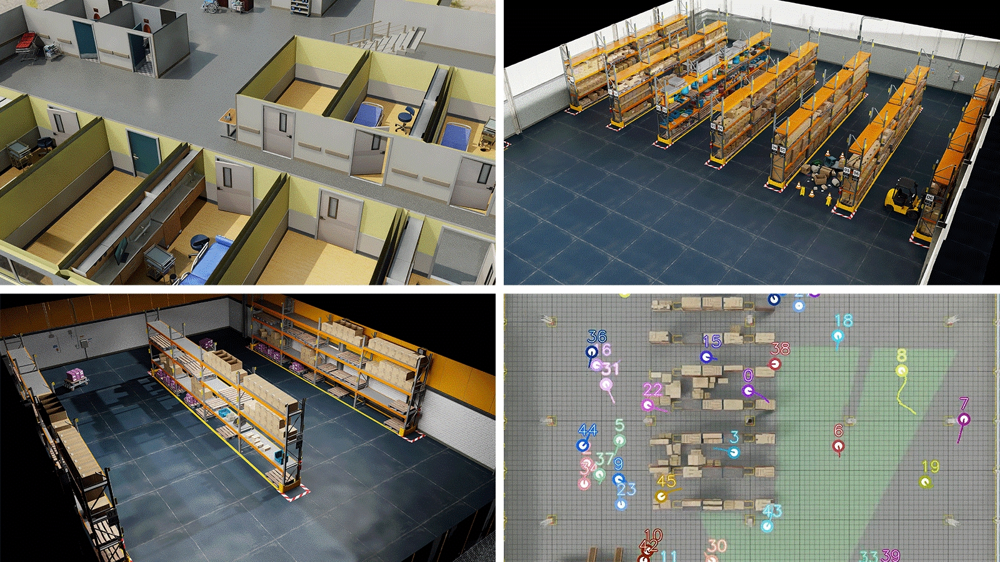

I led organization of the AI City Challenge at CVPR 2024, bringing together a global research community for video understanding and tracking. The challenge attracted over 700 teams from nearly 50 countries, with more than 400 teams participating in multi-camera person tracking.

## Highlights

- NVIDIA contributed 212 hours of 1080p video at 30 frames per second, covering 90 scenes across six virtual environments.
- The Omniverse-generated scenes included nearly 1,000 cameras and around 2,500 digital human characters in settings such as warehouses, stores, and hospitals.
- Omniverse Replicator and Isaac Sim supported configurable scene generation, camera calibration, domain randomization, and ground-truth labeling.
- Ten collaborating institutions and organizations supported the challenge's research and evaluation community.

## Resources

- [NVIDIA's AI City Challenge coverage at CVPR 2024](https://blogs.nvidia.com/blog/ai-city-challenge-omniverse-cvpr/)
- [AI City Challenge](https://www.aicitychallenge.org/)
