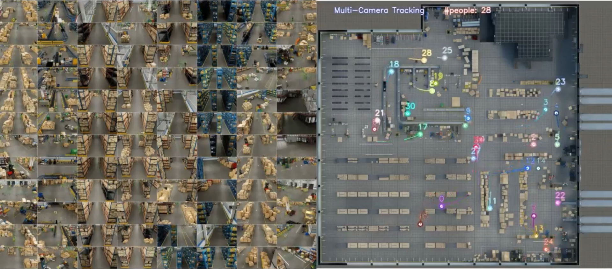

The NVIDIA Metropolis Multi-Camera Tracking AI Workflow is available as a reference for building vision applications across large facilities. I served as technical lead for the project, which was featured in NVIDIA's GTC 2024 keynote.

## Highlights

- Connects synthetic data generation in Omniverse and Isaac Sim with model development in TAO Toolkit.
- Uses DeepStream and Metropolis microservices for video processing, cross-camera tracking, and analytics.
- Provides customizable models trained with real and synthetic data, along with components for application integration.
- Supports use cases such as warehouse activity monitoring, retail movement analysis, and other multi-camera facility applications.

## Resources

- [Multi-camera tracking reference workflow](https://www.nvidia.com/en-us/ai-data-science/ai-workflows/multi-camera-tracking/)
- [AI-powered multi-camera tracking use cases](https://www.nvidia.com/en-us/use-cases/ai-powered-multi-camera-tracking/)
