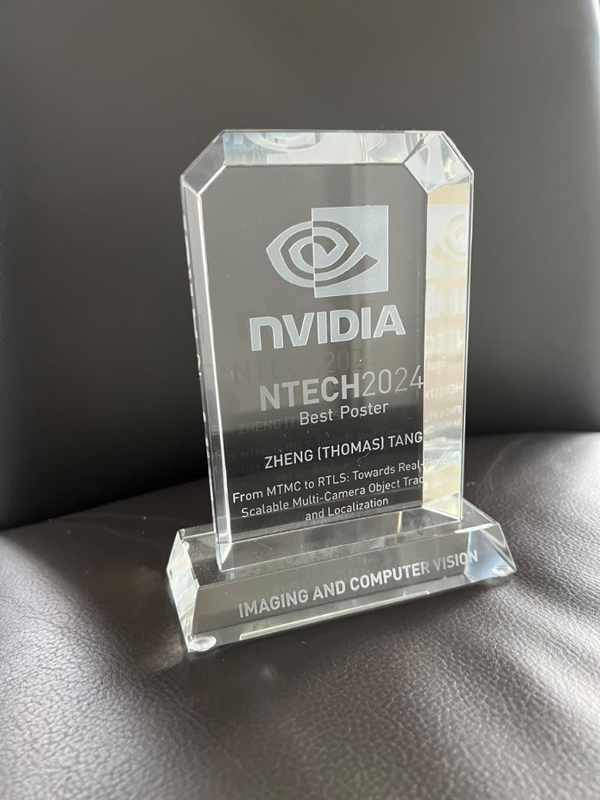

Our team received the Best Presentation and Best Poster awards in the Imaging and Computer Vision Track at NTECH 2024, NVIDIA's annual technical conference.

## Highlights

- **Best Presentation:** “BEV-SUSHI: Multi-Target Multi-Camera 3D Object Detection and Tracking in Bird's-Eye View,” developed in collaboration with NVIDIA Research's DVL group.
- **Best Poster:** “From MTMC to RTLS: Towards Real-Time, Scalable Multi-Camera Object Tracking and Localization.”
- Both projects connect multi-camera perception research with real-time location systems for factories, warehouses, and other large spaces.

## Resources

- [Best Poster Award certificate](/images/NTECH_2024_Best_Poster_Award.jpg)
