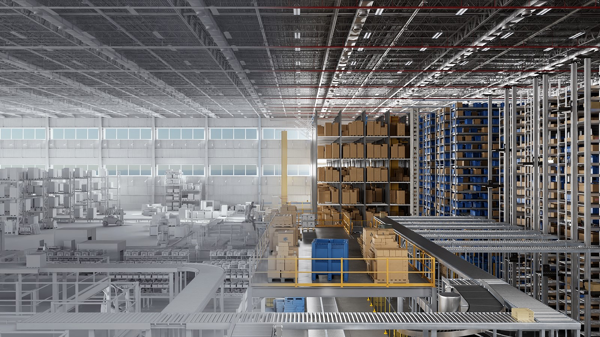

Our Metropolis spatial AI work was featured in Jensen Huang's CES 2025 keynote as part of the Mega Omniverse Blueprint. I helped lead the Metropolis perception work integrated into the demonstration.

## Highlights

- Multi-camera tracking and real-time location systems connect camera observations to the positions of people, vehicles, and robots in industrial spaces.
- Our perception contribution included BEV-SUSHI for 3D understanding and graph-based tracking for cross-camera association.
- Collaboration across Metropolis, Omniverse, and Isaac Sim teams connected these capabilities with digital-twin workflows for simulation and testing before deployment.

## Resources

- [NVIDIA's Mega Omniverse Blueprint announcement](https://blogs.nvidia.com/blog/mega-omniverse-blueprint/)
