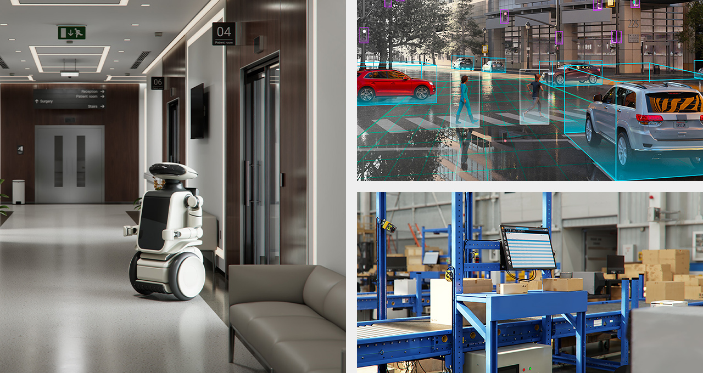

At GTC 2025, NVIDIA released Physical AI Smart Spaces (PAISS) as part of its Open Physical AI Dataset initiative. I led the release and evaluation work for this multi-camera perception resource.

## Highlights

- PAISS supports Track 1 of the 2024 and 2025 AI City Challenge, focused on multi-camera perception and tracking.
- Omniverse-generated scenes provide synchronized multi-camera video and detailed annotations for warehouses, factories, and other smart spaces.
- Shared data and evaluation protocols support reproducible comparisons of multi-target multi-camera tracking and 3D perception methods.

## Resources

- [PhysicalAI-SmartSpaces dataset](https://huggingface.co/datasets/nvidia/PhysicalAI-SmartSpaces)
- [NVIDIA Open Physical AI Dataset announcement](https://blogs.nvidia.com/blog/open-physical-ai-dataset/)
