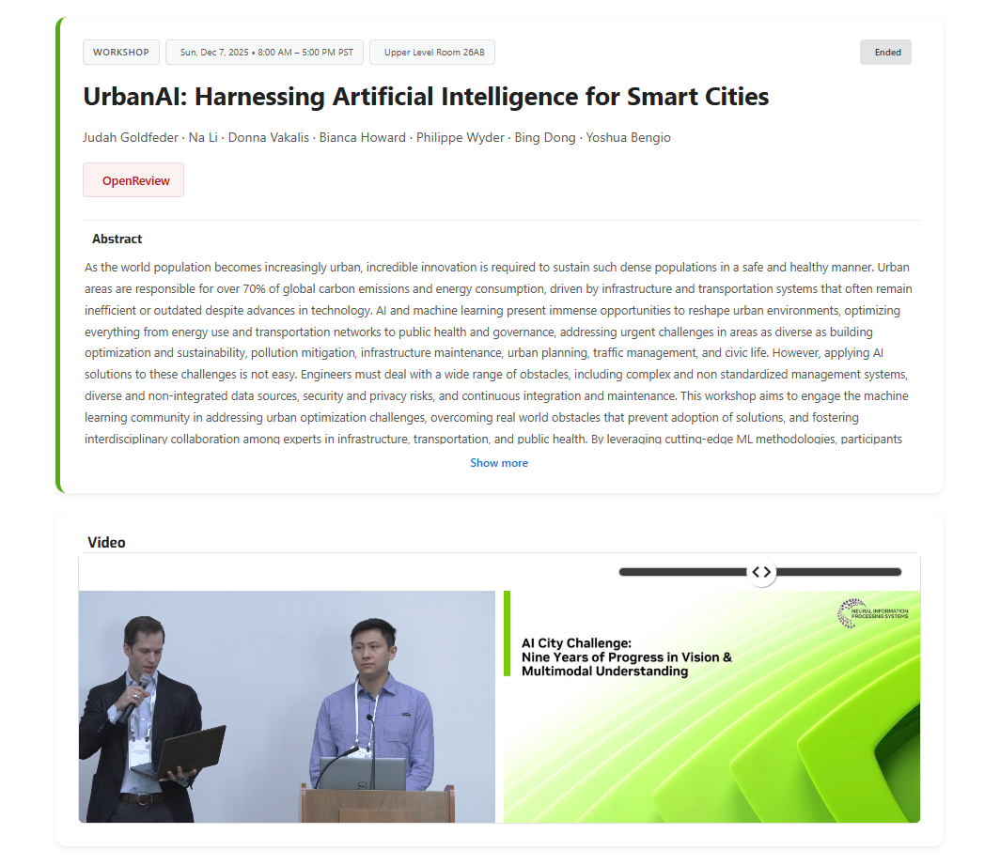

At the UrbanAI Workshop at NeurIPS 2025, I presented our work on multi-camera 3D perception and spatial AI, connecting research benchmarks with model and deployment workflows.

## Highlights

- Reviewed nine years of AI City Challenge work across multi-camera perception, transportation safety, warehouse analytics, and fisheye detection.
- Explained a streaming tracking workflow combining DeepStream perception, cross-camera fusion, real-time location systems, and simulation-to-deployment tools built with Omniverse, TAO Toolkit, and Metropolis microservices.
- Discussed MCBLT/BEV-SUSHI for bird's-eye-view detection and graph-based tracking, and Sparse4D for joint multi-camera 3D detection and tracking.

The workshop provided an opportunity to exchange ideas with researchers working on perception, multimodal reasoning, and urban AI.

## Resources

- [UrbanAI Workshop](https://urbanai2025.github.io/)
- [NeurIPS](https://neurips.cc/)
