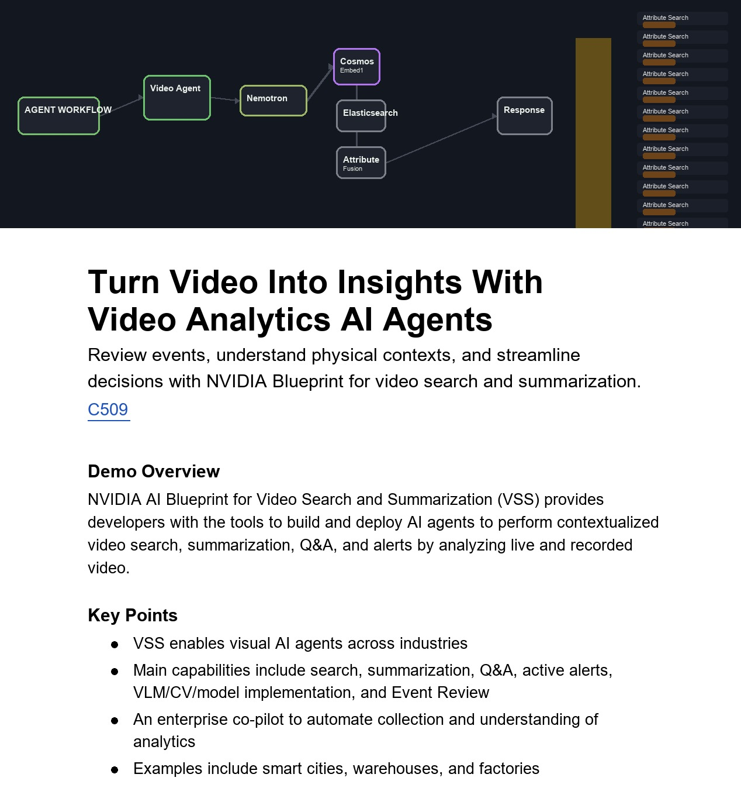

At GTC 2026, I supported NVIDIA's “Turn Video Into Insights With Video Analytics AI Agents” booth demonstration, built on the Video Search and Summarization (VSS) Blueprint.

## Highlights

- Prepared embedding models, person-attribute search checkpoints, representative queries, captions, and evaluation data for video search scenarios.
- Helped debug text embeddings, model packaging, and real-time search-profile integration across demo workflows.
- Connected this work with the VSS Search Agent Workflow, including attribute search, multi-embedding fusion, and critic-based result review. These capabilities were subsequently described in the VSS 3.1.0 release.

The demonstration combined search, summarization, question answering, and event review across examples from smart cities, warehouses, and factories.

## Resources

- [NVIDIA VSS documentation](https://docs.nvidia.com/vss)
- [VSS 3.1.0 release notes](https://docs.nvidia.com/vss/latest/release-notes.html#vss-3-1-0)
