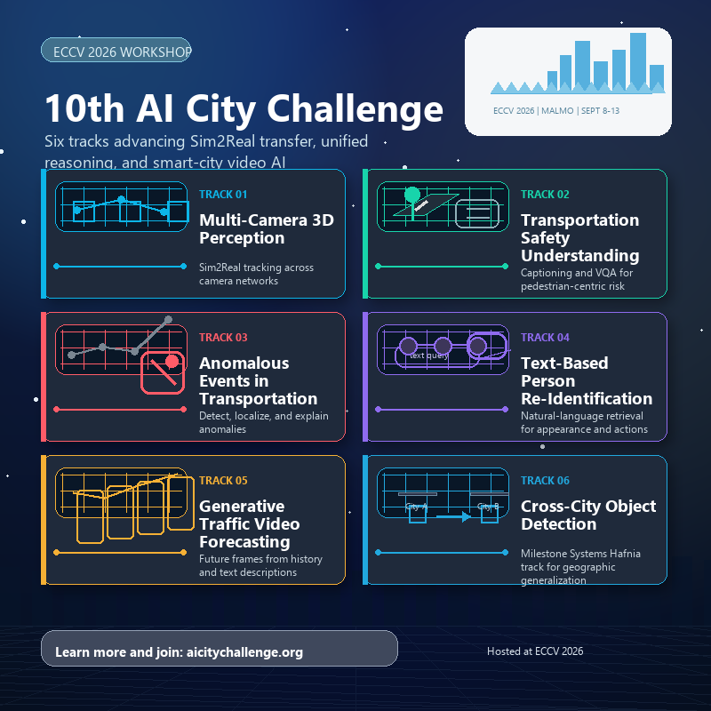

The 10th AI City Challenge was accepted as a half-day workshop at ECCV 2026 in Malmö, Sweden. Its official title, “Towards Sim2Real Transfer and Unified Reasoning,” reflects the challenge's expanded focus on how visual AI generalizes and reasons about real-world environments.

## Highlights

- **Perception and generalization:** Multi-Camera 3D Perception and Cross-City Object Detection evaluate tracking across camera networks and transfer across locations.
- **Safety and reasoning:** Transportation Safety Understanding and Captioning and Anomalous Events in Transportation cover scene descriptions, question answering, anomaly localization, and explanations.
- **Retrieval and prediction:** Text-Based Person Re-Identification and Generative Traffic Video Forecasting explore natural-language search and prediction from video history.

I look forward to continuing the organizing work with our collaborators and participants across these six tracks.

## Resources

- [ECCV 2026 workshop list](https://eccv.ecva.net/Conferences/2026/Workshops)
- [AI City Challenge](https://www.aicitychallenge.org/)
