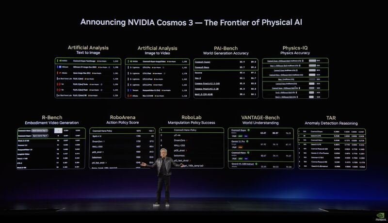

NVIDIA's Cosmos3 release at COMPUTEX 2026 highlighted VANTAGE-Bench and Traffic Anomaly Reasoning (TAR). I contributed to the evaluation infrastructure, benchmark preparation, and launch coordination behind these efforts.

## Highlights

- **VANTAGE-Bench:** Evaluates vision-language understanding of fixed-camera footage across warehouse, transportation, and smart-space scenarios. Its 3,346 image and video assets have 35,027 expert-curated annotations covering semantic, spatial, temporal, and spatio-temporal understanding.
- **TAR:** Provides 44,040 annotations across 10 task types for 3,670 CCTV transportation videos, extending anomaly detection into event explanation, temporal reasoning, and summarization.
- **My contribution:** Supported VANTAGE-Bench evaluation and NeurIPS competition preparation, and helped align TAR's launch as the benchmark for AI City Challenge 2026 Track 3.

These benchmarks connect model evaluation with the practical demands of understanding long videos and small but consequential events.

## Resources

- [NVIDIA Cosmos3 announcement](https://blogs.nvidia.com/blog/cosmos-3-physical-ai-open-world-foundation-model/)
- [VANTAGE-Bench](https://vantage-bench.org/)
- [AI City Challenge 2026 Track 3: TAR](https://www.aicitychallenge.org/2026-track3/)
