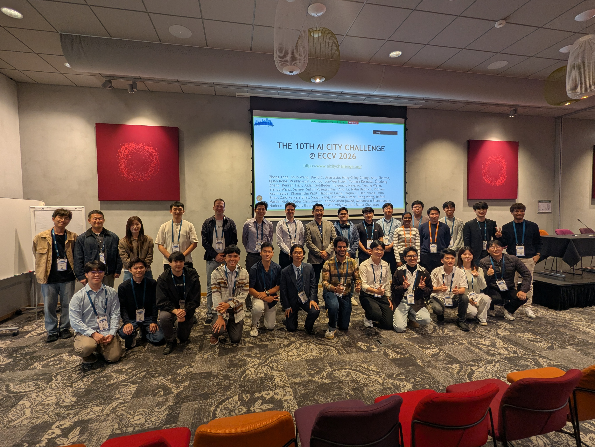

The 10th AI City Challenge concluded at ECCV 2026 in Malmö, Sweden. I helped lead the organizing committee, bringing together participants and winning teams working on visual AI for transportation, smart spaces, and physical AI.

## Highlights

- Six main tracks and two out-of-domain leaderboards covered multi-camera 3D perception, transportation safety, anomaly reasoning, text-based person search, video forecasting, and cross-city detection.
- Across ten editions, the challenge has attracted approximately 2,500 team registrations from 48 countries and regions.
- NVIDIA AI highlighted the winners and reported that four of the top five video-forecasting solutions used NVIDIA Cosmos.
- In an iMerit interview, I discussed cross-city generalization, traffic anomaly reasoning, synthetic-to-real evaluation, and the importance of difficult edge cases.

Thank you to the participants, reviewers, organizers, and collaborators who made this edition possible.

## Resources

- [AI City Challenge](https://www.aicitychallenge.org/)
- [NVIDIA AI coverage](https://x.com/NVIDIAAI/status/2097409504728269183)
- [iMerit interview](https://www.linkedin.com/feed/update/urn:li:activity:7501277492108775424/)
