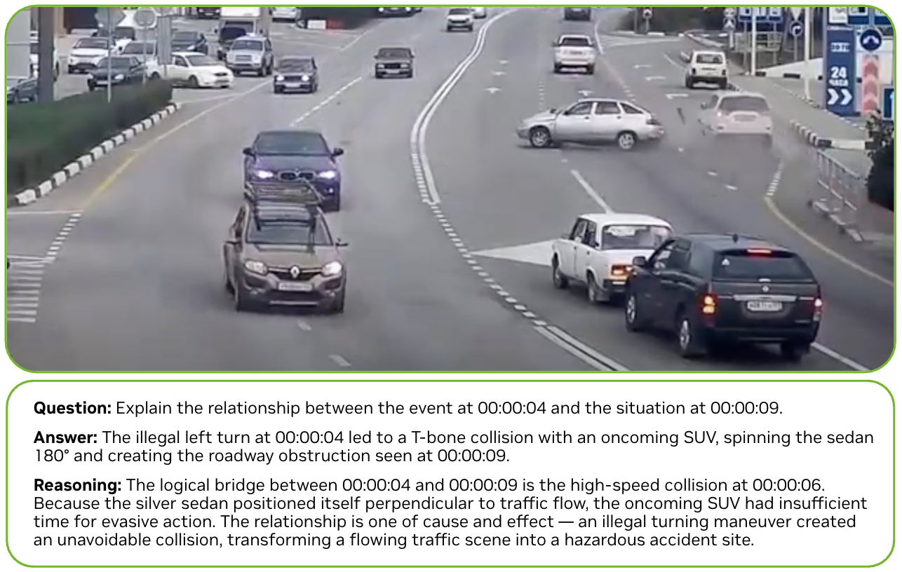
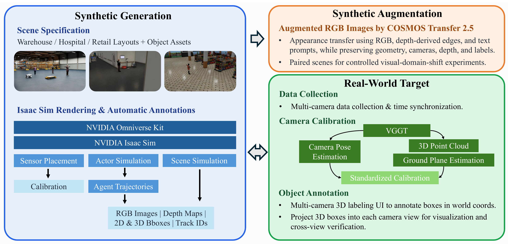

Our Traffic Anomaly Reasoning (TAR) and Physical AI Smart Spaces (PAISS) papers were accepted to NeurIPS 2026. I led PAISS release and evaluation and contributed evaluation infrastructure for TAR.

## Highlights

- **TAR:** Contains 44,040 reasoning annotations across 10 task types for 3,670 CCTV transportation videos, supporting evaluation beyond anomaly detection. It is also the benchmark for AI City Challenge 2026 Track 3.
- **PAISS:** Includes over 280 hours of synchronized 1080p video from nearly 1,800 cameras. Its data pipeline connects Isaac Sim generation, Cosmos Transfer augmentation, and real-world synthetic-to-real evaluation, with protocols for 3D detection and tracking.
- **Community adoption:** PhysicalAI-SmartSpaces had received over 800,000 Hugging Face downloads at this acceptance checkpoint.

Thank you to our collaborators for building the datasets, annotations, evaluation systems, and papers.

## Resources

- [TAR publication](/publications/TAR)
- [PAISS publication](/publications/PAISS)
- [PhysicalAI-SmartSpaces dataset](https://huggingface.co/datasets/nvidia/PhysicalAI-SmartSpaces)
- [AI City Challenge 2026 Track 3](https://www.aicitychallenge.org/2026-track3/)
