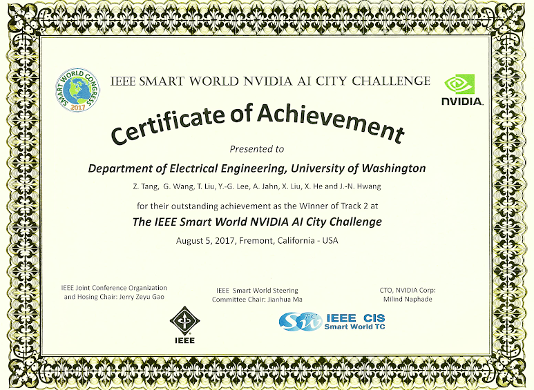
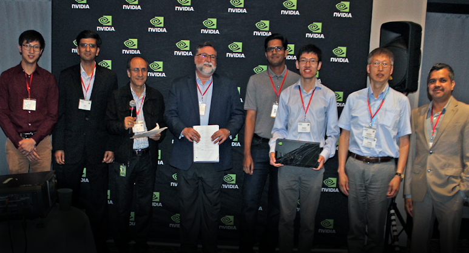



## Summary

This vehicle-tracking system combines 3D deformable vehicle models, constrained multiple-kernel tracking, and camera self-calibration. It uses shape and appearance cues to maintain tracks through occlusion, while tracking feedback refines foreground segmentation. Camera parameters are estimated from walking people, and an ensemble of SSD and YOLO9000 detections supports vehicle localization. The system won the AI City Applications track at the first AI City Challenge.

## Recognition

- Winner of Track 2 (AI City Applications) at the 1st AI City Challenge Workshop in SmartWorld 2017





## Citation

```bibtex
@misc{Tang17AICity17MultiKernelTrack,
  author = {Zheng Tang and Gaoang Wang and Tao Liu and Young-Gun Lee and Adwin Jahn and Xu Liu and Xiaodong He and Jenq-Neng Hwang},
  title = {Multiple-kernel based vehicle tracking using {3D} deformable model and camera self-calibration},
  howpublished = {arXiv:1708.06831},
  year = {2017}
}
```
