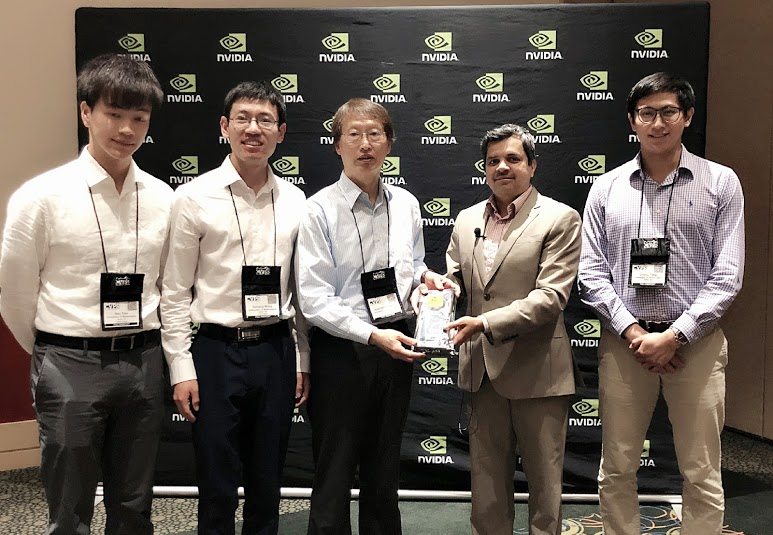



## Summary

This work combines visual and semantic features for vehicle tracking within and across non-overlapping cameras. Adaptive appearance models and trajectory cues support single-camera association; deep features, license-plate cues, and vehicle types support cross-camera re-identification. Evolutionary camera calibration enables 3D speed estimation. The system achieved the top results in both traffic flow analysis and vehicle re-identification at the 2018 AI City Challenge.

## Recognition

- Winner of Track 1 (Traffic Flow Analysis) at the 2nd AI City Challenge Workshop in CVPR 2018
- Winner of Track 3 (Multi-camera Vehicle Detection & ReID) at the 2nd AI City Challenge Workshop in CVPR 2018



## Citation

```bibtex
@inproceedings{Tang18AICity18ICT,
  author = {Zheng Tang and Gaoang Wang and Hao Xiao and Aotian Zheng and Jenq-Neng Hwang},
  title = {Single-camera and inter-camera vehicle tracking and {3D} speed estimation based on fusion of visual and semantic features},
  booktitle = {Proc. CVPR Workshops},
  pages = {108--115},
  address = {Salt Lake City, UT, USA},
  year = {2018}
}
```
