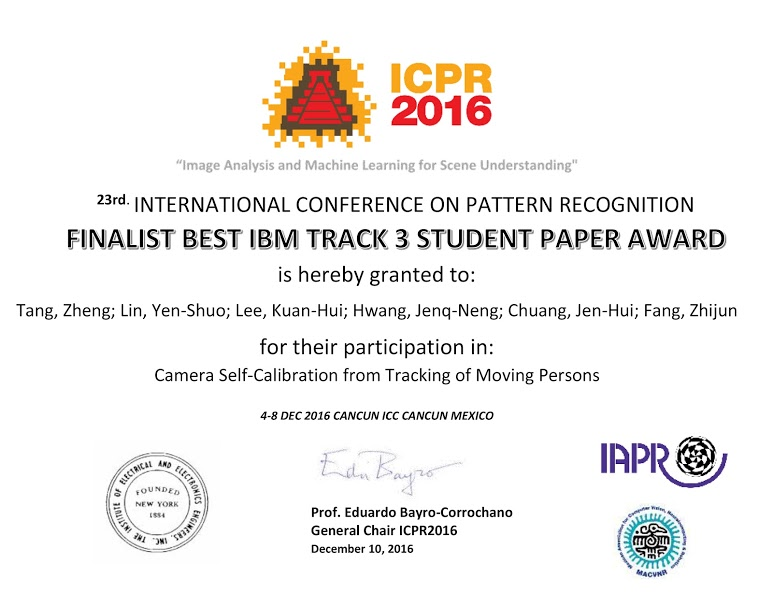
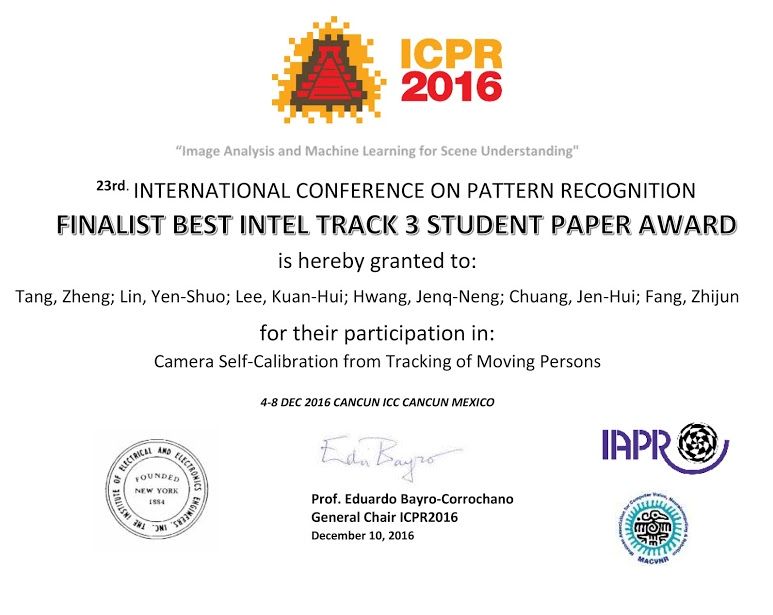



## Summary

This method estimates static-camera parameters from the tracked head and foot positions of walking people. Mean-shift clustering and Laplace regression reduce noise in vanishing-point estimation, while an estimation-of-distribution algorithm refines camera parameters by minimizing reprojection error. Evaluations on real scenes examine calibration robustness and the conversion of image observations into 3D ground-plane measurements.

## Recognition

- Finalist IBM Best Track 3 Student Paper Award in ICPR 2016



- Finalist Intel Best Track 3 Student Paper Award in ICPR 2016



## Citation

```bibtex
@inproceedings{Tang16SelfCalHum,
  author = {Zheng Tang and Yen-Shuo Lin and Kuan-Hui Lee and Jenq-Neng Hwang and Jen-Hui Chuang and Zhijun Fang},
  title = {Camera self-calibration from tracking of moving persons},
  booktitle = {Proc. ICPR},
  pages = {260--265},
  address = {Canc\'{u}n, M\'{e}xico},
  year = {2016}
}
```
